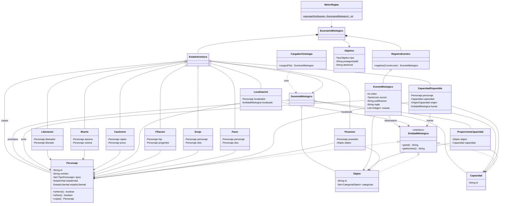

# Modelo Java del sistema inteligente de mitologia griega

Rama: `feature/modelo-java-mitologia` · Proyecto: `sistema-inteligente` · Java 8 · Drools 7.74.1.Final

## 1. Que es el modelo Java

Es el conjunto de clases con el que Drools representa **hechos**: «Perseo es heroe y semidios»,
«Hades posee el CascoHades», «Andromeda esta presa de Ceto». Las reglas `.drl` buscan esos objetos
en la memoria de trabajo (patrones del `when`) y los insertan, modifican o retiran (consecuente `then`).

Todavia **no hay reglas del mito**, ni lector de escenarios, ni generador de respuestas. Esta rama solo
crea y prueba las clases.

## 2. Por que hace falta ademas de la ontologia OWL

- Drools trabaja con objetos Java, no con OWL: cada hecho tiene que ser una instancia de una clase.
- OWL describe el dominio con **mundo abierto** (lo que no se dice puede ser cierto). Un motor de reglas
  usa **mundo cerrado**: si no hay un hecho `Posesion(Perseo, CascoHades)`, Perseo no tiene el casco.
- OWL permite que un individuo tenga varias clases; Java solo tiene herencia simple.
- El estado cambia durante la ejecucion (Medusa muere, el casco cambia de manos). El OWL guarda una
  foto fija.

## 3. Inventario de `ontologia/mitologia.owl` (fuente de verdad)

IRI base `http://www.owl-ontologies.com/Ontology1793785230.owl`. Fichero leido completo; no se ha modificado.

**Clases.** `Personaje` (subclases `Dios`, `Semidios`, `Heroe`, `Mortal`, `Criatura`), `Objeto`
(subclases `Arma`, `Proteccion`, `ArtefactoMagico`, `ParteAnatomica`), `Capacidad`.
Disyunciones: `Objeto ⊥ Personaje`, `Capacidad ⊥ Objeto`, `Capacidad ⊥ Personaje`. Las subclases **no**
son disjuntas entre si.

**Restricciones.** En `Personaje`: `tiene_capacidad only Capacidad`, `tiene_enojo only Dios`,
`tiene_favor only Dios`, `tiene_objeto only Objeto`, `estado_libertad exactly 1`, `estado_vital exactly 1`.
En `Objeto`: `proporciona_capacidad only Capacidad`.

**Propiedades de objeto** (ninguna funcional, transitiva ni simetrica):

| Propiedad | Dominio → Rango | Inversa |
|---|---|---|
| `apresa_a` | Personaje → Personaje | `esta_preso_por` |
| `mata_a` | Personaje → Personaje | `es_asesinado_por` |
| `libera_a` | Personaje → Personaje | `es_liberado_por` |
| `es_hijo_de` | Personaje → Personaje | `tiene_hijo` |
| `tiene_objeto` | Personaje → Objeto | `esta_en_posesion_de` |
| `localiza_a` | Personaje → Personaje ∪ Objeto | — |
| `proporciona_capacidad` | Objeto → Capacidad | — |
| `tiene_capacidad` | Personaje → Capacidad | — |
| `tiene_favor` | Personaje → Dios | — |
| `tiene_enojo` | Personaje → Dios | — |

(Las inversas estan declaradas en un solo sentido, en `apresa_a`, `es_asesinado_por`, `es_hijo_de`,
`es_liberado_por` y `esta_en_posesion_de`; para OWL es suficiente.)

**Propiedades de datos.** `estado_vital` ∈ {"vivo", "muerto"} y `estado_libertad` ∈ {"libre", "preso"},
dominio `Personaje`.

**Individuos.**

| Tipo | Individuos |
|---|---|
| Dios | Atenea, Grayas, Hades, Hefesto, Hermes, Ninfas, Poseidon, Zeus |
| Heroe + Semidios | Perseo (hijo de Zeus y Danae) |
| Mortal | Andromeda (hija de Casiopea), Casiopea, Danae |
| Criatura | Ceto, Medusa, Pegaso |
| Arma | HozAcero (Hermes), EspadaIndestructible (Hefesto) |
| Proteccion | CascoHades (Hades) → Invisibilidad, EscudoBronce (Atenea), EscudoEspejo (sin dueño) → Reflejo |
| ArtefactoMagico | SandaliasAladas (Ninfas) → Vuelo, ZurronMagico (Ninfas), BridaDorada (sin dueño) |
| ParteAnatomica | CabezaMedusa (Medusa) → Petrificacion, OjoGrayas y DienteGrayas (Grayas) |
| Capacidad | Vuelo, Invisibilidad, Reflejo, Petrificacion |

Asertos de estado: todos vivos; todos libres salvo Andromeda (`preso`, `esta_preso_por Ceto`);
`Ceto apresa_a Andromeda`; `Casiopea tiene_enojo Poseidon`. No hay ningun `tiene_favor`,
`tiene_capacidad`, `mata_a`, `libera_a` ni `localiza_a` en los individuos.

### 3.1 Discrepancias detectadas (documentadas, no resueltas)

| # | Discrepancia | Efecto en el modelo |
|---|---|---|
| D1 | Hay dos `mitologia.owl`: el del repositorio (Protege 5, `owl:NamedIndividual`, `rdfs:Datatype`) y el de `PROYECTO FINAL/ontología/` (mas reciente, `rdf:Description`, `owl:DataRange`). Comparados: **mismo contenido**, distinta serializacion. | El cargador entiende las dos. Se usa el del repositorio. |
| D2 | El OWL dice que Andromeda **empieza presa** de Ceto y Ceto **libre**. El enunciado espera que empiece libre y que «Ceto queda libre debido al enojo de Poseidon» y «Andromeda queda presa debido a estar Ceto libre». | El modelo admite ambos estados. Hay que decidir el **conocimiento por defecto** (posible capa sobre el OWL) antes de las reglas. |
| D3 | La salida del enunciado habla de «Capacidad Espejo»; el OWL la llama `Reflejo`. | Se usa `Reflejo` (OWL). El texto narrativo puede decir «Espejo». |
| D4 | El enunciado (§9) dice «Yelmo de Hades en posesion de Hermes» y «Brida de Oro en posesion de Hefestos»; el OWL dice CascoHades → Hades y BridaDorada sin dueño. El propio enunciado avisa de que sus ideas tienen contradicciones a proposito. | Se respeta el OWL. |
| D5 | Faltan en el OWL objetos de los escenarios alternativos: AnilloInvisibilidad, EspejoMano, ConjuroVuelo, AlasIcaro/AlasDedalo, HiloAriadna, EspadaTeseo, CuernoMinotauro, CeraAbejas, Plumas; y personajes de la fase 2 (Minos, Teseo, Ariadna, Minotauro, Icaro, Dedalo, Heracles, Kraken). | Se pueden crear como datos (`new Objeto(...)`, `registrarProporciona`) sin clases nuevas. Las pruebas ya usan AnilloInvisibilidad y ConjuroVuelo. |
| D6 | No existe una clase `Conjuro`. | Un conjuro se modela como `Objeto` (ArtefactoMagico) y su capacidad con origen `CONJURO`. |
| D7 | `tiene_objeto` no es funcional ni inverso-funcional en el OWL, pero un objeto fisico solo puede estar en un sitio. | Java impone **como mucho un poseedor por objeto**. |
| D8 | Grayas y Ninfas son individuos colectivos de tipo `Dios`. | Se respeta. |
| D9 | El catalogo de 48 reglas (Google Drive) **no se ha podido leer**: no habia conexion a Internet. | El modelo se ha contrastado solo con el enunciado y el OWL. Hay que revisarlo frente al catalogo. |

## 4. Clases creadas

```text
sistema-inteligente/src/main/java/dsi/mitologia/
├── Principal.java                 (existente, sin cambios)
├── modelo/                        entidades del dominio
│   ├── EntidadMitologica.java     interfaz: getId(), getNombre()
│   ├── Personaje.java
│   ├── Objeto.java
│   ├── Capacidad.java
│   └── enums/  TipoPersonaje, CategoriaObjeto, EstadoVital, EstadoLibertad, OrigenCapacidad
├── hechos/                        relaciones = hechos para Drools
│   ├── Posesion.java              (mutable: solo el poseedor)
│   ├── ProporcionaCapacidad.java  CapacidadDisponible.java
│   ├── Favor.java  Enojo.java  Filiacion.java
│   ├── Localizacion.java  Cautiverio.java  Muerte.java  Liberacion.java
├── eventos/   EventoMitologico.java, RegistroEventos.java, TipoAccion.java
├── escenario/ DominioMitologico, EstadoAventura, EscenarioMitologico, Objetivo, TipoObjetivo, ResultadoMision
├── ontologia/ CargadorOntologia.java   lee los individuos de mitologia.owl
└── motor/     MotorReglas.java         unico punto que usa la API de Drools
```

| Clase | Responsabilidad | Atributos principales | OWL | Uso en Drools |
|---|---|---|---|---|
| `Personaje` | Un personaje con sus tipos y estado | `id`, `nombre`, `tipos` (EnumSet), `estadoVital`, `estadoLibertad` | `Personaje` y subclases; `estado_vital`, `estado_libertad` | `Personaje(heroe, estadoVital == EstadoVital.VIVO)`; `modify` para cambiar estado |
| `Objeto` | Objeto del mito (inmutable) | `id`, `nombre`, `categorias` | `Objeto` y subclases | `Objeto(arma)` |
| `Capacidad` | Capacidad (inmutable) | `id`, `nombre` | `Capacidad` e individuos | `$v : Capacidad(id == "Vuelo")` |
| `EntidadMitologica` | Algo con id y nombre | — | — | tipo de `Localizacion.localizado` y de la fuente de una capacidad |
| `Posesion` | Quien tiene cada objeto (unica fuente de verdad) | `poseedor` (mutable), `objeto` | `tiene_objeto` / `esta_en_posesion_de` | `modify($pos){ setPoseedor($h) }`, `delete($pos)` |
| `ProporcionaCapacidad` | Objeto da capacidad (estatico) | `objeto`, `capacidad` | `proporciona_capacidad` | patron de union objeto–capacidad |
| `CapacidadDisponible` | Personaje dispone de capacidad por una fuente | `personaje`, `capacidad`, `origen`, `fuente` | `tiene_capacidad` (+ origen) | `insertLogical(...)`; consultar sin mirar la fuente |
| `Favor` / `Enojo` | Relacion con un dios | `personaje`, `dios` | `tiene_favor` / `tiene_enojo` | `Favor(personaje == $h, dios == $d)` |
| `Filiacion` | Parentesco (estatico) | `hijo`, `progenitor` | `es_hijo_de` / `tiene_hijo` | «hijo de quien enoja a Poseidon» |
| `Localizacion` | Ha localizado a alguien o algo | `localizador`, `localizado` | `localiza_a` | `insert(new Localizacion(...))` |
| `Cautiverio` | Captor tiene preso a alguien | `captor`, `preso` | `apresa_a` / `esta_preso_por` | `insert` al apresar, `delete` al liberar |
| `Muerte` | X mato a Y (historia) | `asesino`, `victima` | `mata_a` / `es_asesinado_por` | `insert` al matar |
| `Liberacion` | X libero a Y (historia) | `libertador`, `liberado` | `libera_a` / `es_liberado_por` | `insert` al liberar; objetivo LIBERAR |
| `EventoMitologico` | Un paso de la historia con su «debido a» | `orden`, `accion`, `actor`, `destinatario`, `objeto`, `capacidad`, `descripcion`, `justificacion`, `regla`, `causas` | — | `registro.registrar(EventoMitologico.nuevo(...)...)` |
| `RegistroEventos` | Eventos ordenados de un escenario | lista de eventos | — | `global RegistroEventos registro` |
| `DominioMitologico` | Conocimiento del dominio + estado por defecto | entidades, `proporciona`, pares por defecto | individuos y asertos | no se inserta (solo prototipos) |
| `EstadoAventura` | Estado de una aventura + operaciones con integridad | copias de personajes y listas de hechos | — | `getHechos()` → `insert`; `sincronizarDesde(session.getObjects())` |
| `Objetivo` | Lo que se pregunta | `tipo`, `protagonistaId`, `destinoId` | — | se inserta; las reglas pueden consultarlo |
| `EscenarioMitologico` | Una ejecucion completa | `id`, `pregunta`, `objetivo`, `estado`, `registro`, `condiciones`, `resultado` | — | lo usa `MotorReglas` |
| `CargadorOntologia` | Traduce los individuos del OWL a un dominio | `avisos` | todo el ABox | — |
| `MotorReglas` | Inserta, dispara y recoge | — | — | `MotorReglas.ejecutar(sesion, escenario)` |

## 5. Diagrama de clases

Solo aparecen clases y relaciones que existen en el codigo (los enums se omiten por claridad).



## 6. Tipos multiples de OWL (herencia multiple)

OWL dice `Perseo : Heroe, Semidios`. En Java `class Perseo extends Heroe, Semidios` no compila, y crear
`HeroeSemidios`, `DiosCriatura`... explotaria. Alternativas estudiadas:

| Opcion | Pros | Contras |
|---|---|---|
| Jerarquia de clases (`Heroe extends Personaje`) | Patron `Heroe()` directo | No admite dos tipos |
| Interfaces marcadoras + una clase por combinacion | Patrones `Heroe()` | Una clase por combinacion de tipos |
| **Conjunto de tipos en `Personaje`** (elegida) | Cualquier combinacion; los tipos son datos del OWL | Patron `Personaje(heroe)` en lugar de `Heroe()` |

```java
Personaje perseo = new Personaje("Perseo", "Perseo",
        EnumSet.of(TipoPersonaje.HEROE, TipoPersonaje.SEMIDIOS));
perseo.isHeroe();     // true
perseo.isSemidios();  // true
```

En DRL: `$h : Personaje(heroe)` o `Personaje(tipos contains TipoPersonaje.SEMIDIOS)`. La nota I del
enunciado sugiere usar clases concretas; aqui se prefiere el conjunto porque el propio OWL exige que un
individuo tenga dos tipos. Igual para `Objeto` (`categorias`).

## 7. Estados

`EstadoVital {VIVO, MUERTO}` y `EstadoLibertad {LIBRE, PRESO}` son enums con el literal del OWL
(`getValorOwl()`, `desdeOwl("vivo")`). Cardinalidad 1 → un campo no nulo: es imposible estar vivo y muerto
a la vez, y `setEstadoVital(null)` lanza excepcion. Estado inicial por defecto: vivo y libre (o lo que diga el OWL).

```
Personaje(id == "Medusa", estadoVital == EstadoVital.VIVO)       // ¿esta viva Medusa?
Personaje(id == "Andromeda", estadoLibertad == EstadoLibertad.PRESO)
```

> **Cuidado con la reactividad de propiedades de Drools 7:** al hacer `modify($p){ setEstadoVital(...) }`
> Drools reevalua los patrones que miran `estadoVital`. Por eso `Personaje` **no** tiene getters derivados
> como `isVivo()`: un patron `Personaje(vivo)` no se enteraria del cambio. Los getters `isHeroe()`... son
> seguros porque los tipos no cambian.

`Cautiverio` y `estadoLibertad` se mantienen sincronizados: `apresar` pone PRESO e inserta el Cautiverio;
`liberar` retira todos los Cautiverio del preso y pone LIBRE. Un hecho `Cautiverio` implica siempre preso
PRESO. Se admite PRESO sin captor conocido (por si el conocimiento por defecto dice «Ceto esta preso»).

## 8. Posesiones

Unica fuente de verdad: `Posesion`. `Personaje` no tiene lista de objetos y `Objeto` no tiene dueño.
Como mucho una Posesion por objeto. Transferir **modifica el mismo hecho**:

```java
estado.transferirObjeto(hades, perseo, casco);   // misma Posesion, otro poseedor
estado.poseedorDe(casco);                        // perseo
```

Operaciones: `otorgarObjeto` (objeto sin dueño), `transferirObjeto`, `retirarObjeto`
(«Atenea no tiene Escudo de Bronce»), `transformarObjeto` (EscudoBronce → EscudoEspejo).
Errores de integridad (`IllegalStateException`): transferir lo que no se posee, dar un objeto que ya tiene
alguien, dar algo a un muerto.

## 9. Capacidades

La capacidad es independiente del objeto. Hay **un hecho `CapacidadDisponible` por cada fuente**:

| Origen | Fuente | Ejemplo |
|---|---|---|
| `PROPIA` | ninguna | fuerza de Heracles |
| `OBJETO` | `Objeto` poseido | CascoHades → Invisibilidad |
| `CONJURO` | `Objeto` (el conjuro) | ConjuroVuelo → Vuelo |
| `MONTURA` | `Personaje` capturado | Pegaso → Vuelo |

```java
estado.concederCapacidad(CapacidadDisponible.deObjeto(perseo, invisibilidad, casco)); // valida que posee el casco
estado.concederCapacidad(CapacidadDisponible.deObjeto(perseo, invisibilidad, anillo));
estado.retirarObjeto(perseo, casco);              // se va solo la fuente "casco"
estado.tieneCapacidad(perseo, invisibilidad);     // true, por el anillo
```

Java **no** concede capacidades por su cuenta (nota O del enunciado: Java no infiere). Lo que si hace es
mantener la integridad: al perder el objeto (o liberar/morir la montura) se retiran las capacidades que
dependian de esa fuente. En Drools lo mismo se consigue con `insertLogical` (ver §13). La duracion
limitada de una capacidad queda pendiente.

## 10. Escenarios y aislamiento

```java
DominioMitologico dominio = new CargadorOntologia().cargar(new File("../ontologia/mitologia.owl"));
EscenarioMitologico esc = new EscenarioMitologico("F1-1", "Puede Perseo liberar a Andromeda",
        new Objetivo(TipoObjetivo.LIBERAR, "Perseo", "Andromeda"), dominio);
EstadoAventura e = esc.getEstado();
esc.agregarCondicion("Perseo tiene el favor de Atenea");
e.agregarFavor(e.getPersonaje("Perseo"), e.getPersonaje("Atenea"));
```

- `DominioMitologico`: se rellena una vez; nadie lo modifica.
- `EstadoAventura.inicial(dominio)`: **copia** los personajes y crea hechos nuevos. `Objeto`, `Capacidad`
  y `ProporcionaCapacidad` son inmutables y se comparten sin riesgo.
- Cada escenario tiene su `RegistroEventos` y su `KieSession`. No hay estado mutable en `static`.

## 11. Eventos

```java
registro.registrar(EventoMitologico.nuevo(TipoAccion.OBTENER_OBJETO, perseo)
        .destinatario(hades).objeto(casco)
        .justificacion("tener el favor de Hades")
        .regla("Un dios entrega su objeto")
        .causas(eventoAnterior));
```

El registro asigna el orden (E1, E2...). `causas` guarda los numeros de los eventos que provocaron este,
para conservar la cadena causal. El futuro generador de `RespuestaF1_x.txt` recorrera `getEventos()`.

## 12. Operaciones de cambio de estado

| Operacion | Integridad comprobada |
|---|---|
| `otorgarObjeto`, `transferirObjeto`, `retirarObjeto`, `transformarObjeto` | un poseedor por objeto; origen posee; receptor vivo |
| `concederCapacidad`, `retirarCapacidad` | fuente valida; sin duplicados |
| `matar(asesino, victima)`, `morir(p)` | no matar a un muerto; asesino vivo |
| `apresar`, `liberar` | ambos vivos; no apresar a un preso; no liberar a un libre |
| `registrarLocalizacion` | sin duplicados; rango Personaje ∪ Objeto (por tipos) |
| `agregarFavor`, `agregarEnojo`, `retirar...` | el dios debe ser `Dios` (rango OWL) |

Estas operaciones dicen **como** cambiar el estado sin contradicciones; **cuando** hacerlo lo deciden las reglas.

## 13. Como usara Drools estas clases

`MotorReglas.ejecutar(sesion, escenario)` inserta `escenario.getHechosParaDrools()`, pone el global
`registro`, llama a `fireAllRules()` y recoge el estado final con `sincronizarDesde(sesion.getObjects())`.

Dentro de las reglas, siguiendo las notas H-O del enunciado, el consecuente usa directamente
`insert` / `modify` / `delete` sobre los hechos:

| Accion | DRL |
|---|---|
| Transferir objeto | `modify($pos) { setPoseedor($heroe) }` |
| Matar | `modify($v) { setEstadoVital(EstadoVital.MUERTO) }` + `insert(new Muerte($a, $v))` |
| Apresar | `modify($p) { setEstadoLibertad(EstadoLibertad.PRESO) }` + `insert(new Cautiverio($c, $p))` |
| Liberar | `delete($cautiverio)` + `modify($p) { setEstadoLibertad(EstadoLibertad.LIBRE) }` + `insert(new Liberacion($l, $p))` |
| Localizar / favor / enojo | `insert(new Localizacion($x, $y))`, `insert(new Favor(...))` |
| Capacidad por objeto | `insertLogical(CapacidadDisponible.deObjeto($p, $c, $o))` (se retira sola al perder la Posesion) |
| Narrar | `registro.registrar(EventoMitologico.nuevo(...)...)` |

- `modify` (o `update`) es obligatorio al cambiar un hecho ya insertado; un setter sin `modify` deja la
  red RETE desincronizada.
- `delete` para los hechos inmutables que dejan de ser ciertos (Cautiverio, Favor...).
- `==` entre objetos en DRL usa `equals`: los hechos se comparan por identificador / valor.
- Las operaciones de `EstadoAventura` se usan en Java para preparar el estado (conocimiento por defecto +
  condiciones del escenario) y en las pruebas.

La prueba `IntegracionDroolsModeloTest` demuestra ambas cosas: una regla reconoce `Personaje(heroe, semidios)`
y `Posesion`, y una capacidad insertada con `insertLogical` desaparece al retirar la posesion.

## 14. Decisiones de diseño

1. Tipos OWL como `EnumSet` (§6).
2. Una clase pequeña por relacion OWL, con nombres del dominio, para que los antecedentes sean patrones planos.
3. Inversas: un solo hecho por par (Cautiverio sirve para `apresa_a` y `esta_preso_por`).
4. Una sola Posesion por objeto, mutable solo en el poseedor.
5. Hechos de relacion inmutables con igualdad por valor; `Posesion` con identidad.
6. Capacidades con origen y fuente; integridad en Java, `insertLogical` en Drools.
7. Dominio inmutable + estado copiado por escenario; nada estatico mutable.
8. El modelo no depende de Drools salvo `MotorReglas`.
9. El OWL se lee con el DOM de Java 8 (sin OWL API) y no se modifica.
10. Codigo sin tildes ni eñes (lo pide el enunciado).

## 15. Elementos del OWL aun no incorporados

- No se aplica razonamiento OWL (dominios, rangos, `only`, disyuncion) al cargar: el cargador solo copia
  asertos. Algunas restricciones se comprueban a mano en Java (favor/enojo solo de un Dios, cardinalidad 1).
- Los `rdfs:comment` (metadatos) no se cargan.
- No hay `rdfs:label`: los nombres legibles («Casco de Hades») se tendran que definir para la narracion.
- `mata_a`, `libera_a` y `localiza_a` se soportan pero el OWL no tiene asertos de ellos.

## 16. Pendiente para implementar las reglas

1. Decidir el conocimiento por defecto (D2) y los objetos alternativos (D5).
2. Revisar el modelo frente al catalogo de 48 reglas (D9).
3. Lector de `EscenarioF2-x.txt` → `EscenarioMitologico`.
4. Agenda «Informacion Inicial» y agenda de la historia.
5. Reglas del mito (empezando por la de §17).
6. Generador de `RespuestaFx_y.txt` a partir de `RegistroEventos`.
7. Duracion limitada de capacidades, si alguna regla la necesita.
8. Retirar `reglas/prueba-integracion.drl` cuando haya reglas reales.

## 17. Proxima regla: Atenea entrega el escudo

«SI Perseo tiene el favor de Atenea Y Atenea posee el escudo de bronce, ENTONCES Atenea entrega el escudo
a Perseo», escrita de forma general (cualquier personaje vivo, cualquier dios, cualquier objeto):

```
import dsi.mitologia.modelo.Personaje
import dsi.mitologia.hechos.Favor
import dsi.mitologia.hechos.Posesion
import dsi.mitologia.eventos.EventoMitologico
import dsi.mitologia.eventos.TipoAccion
import dsi.mitologia.modelo.enums.EstadoVital
global dsi.mitologia.eventos.RegistroEventos registro

rule "Un dios entrega su objeto a quien tiene su favor"
when
    $p   : Personaje(estadoVital == EstadoVital.VIVO)
    $d   : Personaje(dios)
           Favor(personaje == $p, dios == $d)
    $pos : Posesion(poseedor == $d, $o : objeto)
then
    modify($pos) { setPoseedor($p) }
    registro.registrar(EventoMitologico.nuevo(TipoAccion.OBTENER_OBJETO, $p)
        .destinatario($d).objeto($o)
        .justificacion("tener el favor de " + $d.getNombre())
        .regla(drools.getRule().getName()));
end
```

Para el escudo concreto, con el escenario 1 cargado (`Perseo tiene el favor de Atenea`), la regla empareja
`Favor(Perseo, Atenea)` con `Posesion(Atenea, EscudoBronce)` y cambia el poseedor. Al cambiarlo, la regla
deja de cumplirse para ese objeto y no se reactiva. Antes de escribirla hay que decidir con el catalogo si
el dios entrega **todos** sus objetos o solo los necesarios (p. ej. que Hermes no entregue algo que no
toca), porque la version general podria hacer que un dios lo de todo.
